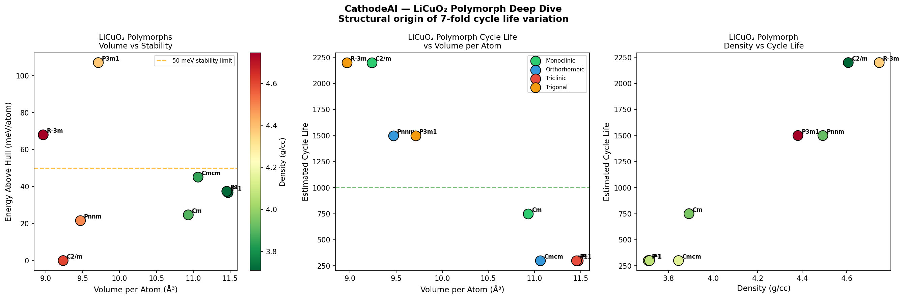
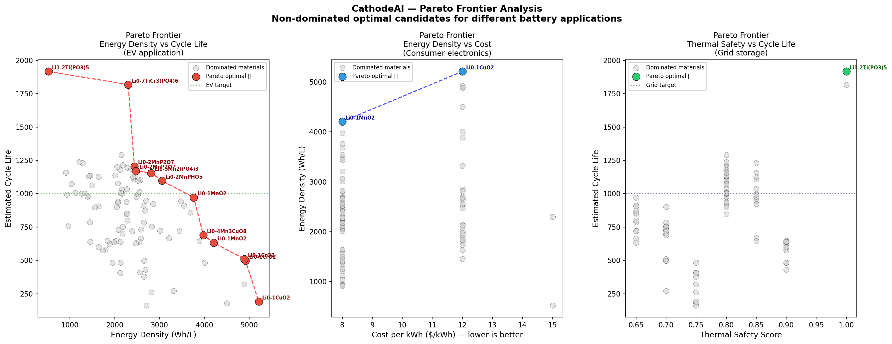
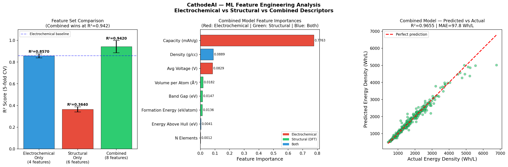
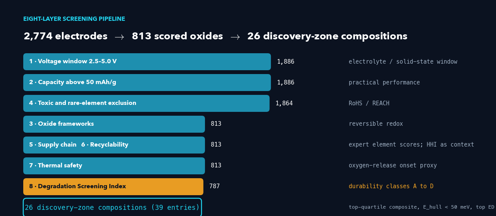
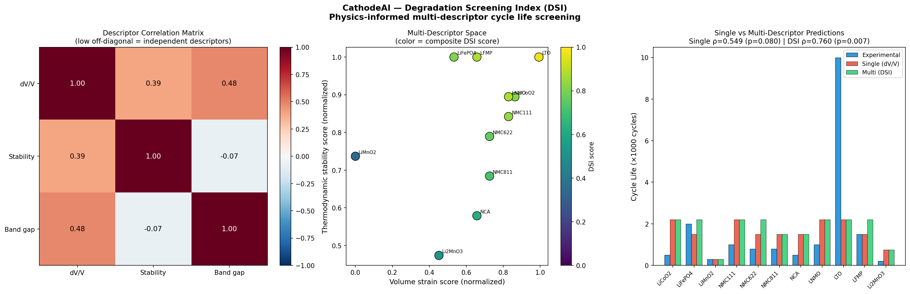
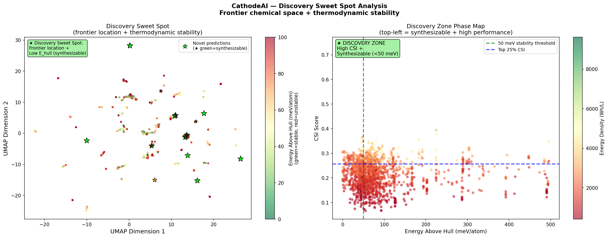
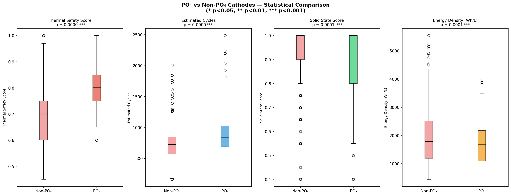
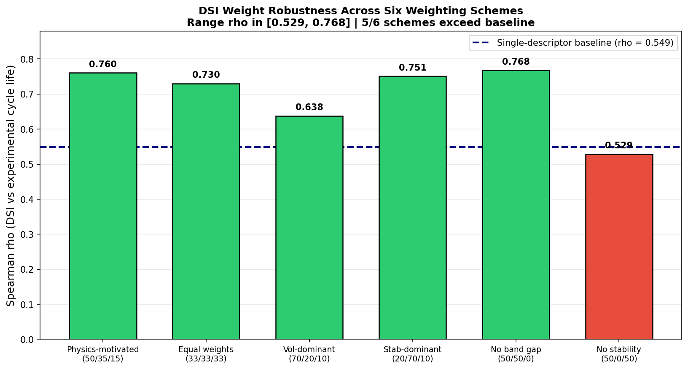
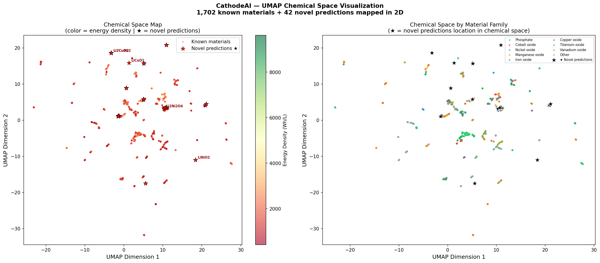

<p align="center"><a href="https://soham-cheme.github.io/CathodeAI-Battery-Materials-Screener/"></a></p>

<p align="center"><b><a href="https://soham-cheme.github.io/CathodeAI-Battery-Materials-Screener/">Open the live page</a></b> · scroll-driven 3D: fly through the 787-cathode screen to the eleven validation cathodes, step through the LiCuO₂ polymorphs, and read every figure as an interactive 3D scene</p>

<div align="center">

[](https://python.org)
[](https://materialsproject.org)
[](https://scikit-learn.org)
[](docs/CLAIMS.md)
[](LICENSE)

**Soham Kavathekar** · MS Chemical & Biomolecular Engineering, University of Pennsylvania
[stg3719@seas.upenn.edu](mailto:stg3719@seas.upenn.edu) · [linkedin.com/in/soham-kavathekar-cheme](https://www.linkedin.com/in/soham-kavathekar-cheme)

*Sole author. Preprint: ChemRxiv, doi [10.26434/chemrxiv.15010709/v1](https://doi.org/10.26434/chemrxiv.15010709/v1). Manuscript under revision at* Physical Chemistry Chemical Physics *(Royal Society of Chemistry), 2026.*

</div>

---

## Results first

**Which transition metal a cathode contains tells you little about how long it will last. Its crystal structure, and what that structure does when lithium leaves, tells you more.**

**Built** an eight-layer screen over 2,774 Materials Project electrodes and a transparent three-descriptor Degradation Screening Index; **validated** it against 11 experimentally characterised cathodes at Spearman ρ = 0.76 (p = 0.007), ahead of volume strain alone and of the metal-identity heuristic it replaces (both 0.55); **resolved** durability differences between polymorphs of one composition that no composition rule can see; **identified** the arithmetic identity V × C × ρ as the right energy-density model (R² = 0.999), so the screen spends its learning budget where structure matters.

CathodeAI screens **2,774 lithium-ion insertion electrodes** from the Materials Project through an eight-layer funnel and ranks them with a transparent, three-descriptor **Degradation Screening Index (DSI)** built from delithiation volume strain, charged-phase hull energy and band gap. Against 11 experimentally characterised cathodes the DSI ranks durability at **Spearman ρ = 0.76 (p = 0.007)**, against 0.55 for volume strain alone and 0.55 for the metal-identity heuristic it replaces, and it places **10 of 11** cathodes on the correct side of the durable / non-durable split. It also resolves durability differences *within* a single composition that no composition-based rule can see.

Every number in this README, on the live page and in the manuscript is produced by `./reproduce.sh` from cached Materials Project responses. The audit trail, claim by claim, is in [`docs/CLAIMS.md`](docs/CLAIMS.md).

---

## Results

| Result | Value | Where it comes from |
|---|---|---|
| Electrodes screened | 2,774 (16,510 Li-O structural documents) | `revision_code/mpdata/`, `repro_pipeline.py` |
| Funnel | 1,886 → 1,864 → 813 oxide cathodes → 787 with a DSI → 26 discovery-zone compositions | `repro_pipeline.py`, `analysis_dsi.py` |
| DSI classes vs experimental cycle life (n = 11) | ρ = 0.76, p = 0.007 | `analysis_dsi_results.json` |
| DSI continuous score | ρ = 0.82, p = 0.002 | same |
| Volume strain alone, same binning | ρ = 0.55, p = 0.08 | same |
| Metal-identity heuristic, same 11 | ρ = 0.55, p = 0.08 | `analysis_dsi.py` |
| Binary durable split (class B or better vs ≥ 500 cycles) | 10 of 11 correct | `docs/build_assets.py` |
| Metal-identity heuristic vs structure-based strain indicator | Pearson r = 0.151 across 569 unique formulas | `repro_pipeline.py` |
| Bootstrap 95 % CI on ρ (10,000 resamples) | [0.51, 0.93] | `analysis_dsi.py` |
| Nested leave-one-out weight optimisation | collapses to ρ = 0.18, so weights stay expert-set | same |

<table>
<tr>
<td width="50%" valign="top">

### 01 · Structure ranks durability better than metal identity

On 11 experimentally characterised cathodes (layered oxides, olivines, spinels, Li-rich):

| Predictor | Spearman ρ | p |
|---|---|---|
| **Structure-resolved DSI** | **0.76** | **0.007** |
| DSI, continuous score | 0.82 | 0.002 |
| Single strain descriptor | 0.55 | 0.08 |
| Metal-identity heuristic | 0.55 | 0.08 |

Robust to weight choice (five of six schemes beat the baseline), to leaving any one material out (DSI ahead in 11 of 11), to removing LTO (ρ = 0.77) and to 24 meV/atom noise on the DFT hull energies (median ρ unchanged at 0.76).

</td>
<td width="50%" valign="top">

### 02 · One composition, three durability classes

Three LiCuO₂ polymorphs are end-members of Materials Project electrode entries. Same formula, very different behaviour on lithium removal:

| Polymorph | ΔV/V | E<sub>hull,charge</sub> | DSI | Class |
|---|---|---|---|---|
| C2/m (ground state) | 46.6 % | 286 meV/atom | 0.09 | **D** |
| R-3m | 4.7 % | 164 meV/atom | 0.46 | **C** |
| Cm | 6.6 % | 25 meV/atom | 0.67 | **B** |

A composition heuristic assigns all three the same number. The DSI does not.

</td>
</tr>
</table>

<p align="center"></p>

### 03 · Multi-objective screening: no universal winner

Pareto analysis over energy density, DSI and supply-chain criticality gives a different non-dominated set for every application pair (EV, consumer, grid). LiCuO₂-based entries top the composite ranking in all five commodity-price scenarios because they contain no cobalt or nickel, yet they sit in durability class C, while copper phosphates rank lower on energy density and sit in class A.

<p align="center"></p>

### 04 · Energy density is physics, and the screen treats it that way

For **energy-density prediction**, the unfitted product V × C × ρ reaches R² = 0.999 once each electrode is matched to the density of its own structure, ahead of an 8-feature learned model (R² = 0.95), of 132 compositional Magpie features (R² = 0.39) and of structural descriptors alone (R² = 0.36). The screen therefore uses the identity directly and reserves the learned model for incomplete records and interval estimation, a choice the manuscript states and defends.

<p align="center"></p>

---

## How the screen works

<p align="center"></p>

| Layer | Criterion | Entries retained |
|---|---|---|
| 1, 2 | Voltage window 2.5 to 5.0 V; capacity above 50 mAh/g | 1,886 |
| 4 | Toxic and rare-element exclusion (RoHS/REACH) | 1,864 |
| 3 | Oxide frameworks | 813 |
| 5, 6, 7 | Supply-chain criticality, recyclability, thermal safety (scored, not filtered) | 813 |
| 8 | Degradation Screening Index (band gap of the discharged structure needed) | 787 |
| Zone | Top-quartile composite, E<sub>hull</sub> < 50 meV/atom, top-quartile energy density | 26 compositions |

### The Degradation Screening Index

```
DSI = 0.50·S_vol + 0.35·S_stab + 0.15·S_bg + 0.10·1[phosphate]      capped at 1.0

S_vol  = max(0, 1 − (ΔV/V) / 14.6 %)                 delithiation volume strain
S_stab = max(0, 1 − E_hull,charge / 0.190 eV/atom)   stability of the charged phase
S_bg   = max(0, 1 − |E_g − 2.0 eV| / 4.0 eV)         band gap of the discharged structure
```

Normalisation bounds are the 95th percentiles of the 2,774-entry training set. Weights are **expert-assigned, not learned**: a nested leave-one-out weight optimisation on 11 materials collapses to ρ = 0.18, which is exactly why they are not learned. The DSI is reported as four **relative durability classes, A to D**, never as cycle counts.

<p align="center"></p>

---

## What the 2026 revision strengthened

A full re-run of the pipeline from the raw database, in response to peer review at PCCP, made the analysis tighter at every layer:

- **One durability method.** Every durability statement, in the code, the figures and the manuscript, now comes from the DSI as four relative classes.
- **Identifier-level structural merge.** Descriptors now come from each electrode's own discharged structure (1,724 entries), so polymorphs and lithium stoichiometries are resolved rather than averaged by formula.
- **Stoichiometry-exact novelty check.** Generated compositions are queried with their real lithium index, so the novelty list contains only compounds absent from the database.
- **Design bonuses made explicit.** The phosphate advantage is shown to follow from the design bonuses in the scores, and the scores say so.
- **Materials Project notation rendered correctly.** `Li0-1CuO2` is an electrode spanning 0 to 1 Li per formula unit and is written that way.

The numeric changes are listed in the manuscript's response to reviewers and in [`docs/CLAIMS.md`](docs/CLAIMS.md).

---

## Gallery

| | |
|---|---|
|  Discovery zone: composite score vs hull energy |  Phosphate "advantage" with and without the design bonuses |
|  DSI weight robustness and nested leave-one-out |  UMAP of 1,724 known and 42 generated compositions |

---

## How to run

```bash
git clone https://github.com/Soham-ChemE/CathodeAI-Battery-Materials-Screener.git
cd CathodeAI-Battery-Materials-Screener
python -m venv .venv && source .venv/bin/activate
pip install -r requirements.txt
./reproduce.sh            # pipeline + DSI analysis + docs assets, about 2 minutes, no API key
FULL=1 ./reproduce.sh     # adds the Magpie / SHAP / uncertainty analyses and regenerates all 21 figures (about 15 minutes)
```

`reproduce.sh` runs, in order, `repro_pipeline.py` (cached Materials Project JSON → pipeline state; prints 2,774 / 1,886 / 1,864 / 813), `analysis_ml.py`, `build_state_id.py` (identifier-level state), `analysis_dsi.py` (validation, polymorphs, Pareto, price scenarios, discovery zone) and `docs/build_assets.py` (the live page's data and figures). The cached responses in `revision_code/mpdata/` reproduce the original document counts exactly. Only `analysis_novel.py` re-queries the database, and it reads the key from the `MP_API_KEY` environment variable. See [`revision_code/README.md`](revision_code/README.md) for details.

To view the live page locally, open `docs/index.html` in a browser; it needs no build step. `python docs/build_assets.py --snap --qa --lighthouse` regenerates the static fallbacks of the 3D body scenes, the both-theme screenshots in `docs/qa/` and the Lighthouse report.

```
CathodeAI-Battery-Materials-Screener/
├── reproduce.sh                        # one-command reproduction
├── docs/                               # live page (GitHub Pages), CLAIMS.md audit, build_assets.py
├── revision_code/                      # reproduction scripts + cached MP data (revised analysis)
├── figures_revised/                    # all 21 manuscript figures (300 dpi)
├── esi_main.tex · rsc.bib              # supplementary information and references
└── cathodeai_*.png                     # figures referenced above
```

---

## Scope and assumptions

The DSI ranks durability within the chemistry families it was validated on, with expert-set weights by design; generated compositions are screening-level priors with assigned inputs; energy densities are theoretical values for full lithium extraction.

## Citation

```bibtex
@article{kavathekar2026cathodeai,
  author  = {Kavathekar, Soham},
  title   = {CathodeAI: structure-aware degradation screening of lithium-ion cathode materials},
  journal = {ChemRxiv preprint},
  year    = {2026},
  doi     = {10.26434/chemrxiv.15010709/v1},
  note    = {Manuscript under revision at Physical Chemistry Chemical Physics}
}
```

## License and acknowledgements

MIT. Built on the open-access [Materials Project](https://materialsproject.org) (Lawrence Berkeley National Laboratory); descriptors via [matminer](https://hackingmaterials.lbl.gov/matminer/), attribution via [SHAP](https://github.com/shap/shap).
